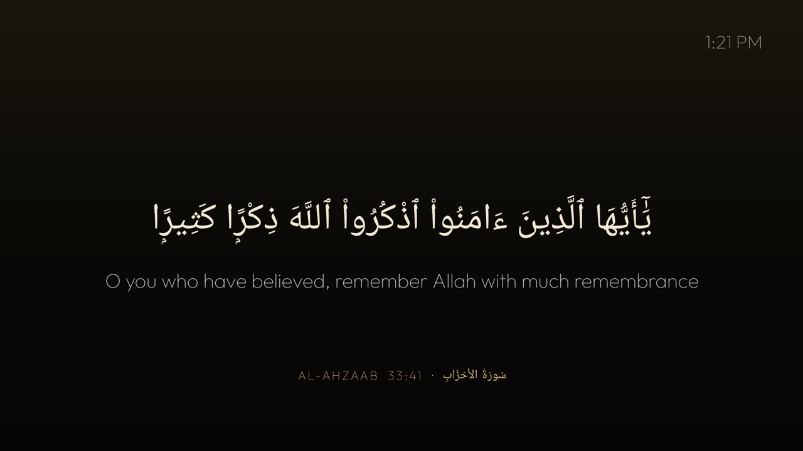

# Quran screensaver for Android TV

A screensaver (Android's "Daydream") for Android TV and Google TV that shows one ayah at a time: the Arabic, a
translation underneath, and the surah and ayah number. A new ayah fades in every 90 seconds, and a small clock sits
in the corner. Against burn-in, everything drifts together a few dp round a small circle, one step every two
minutes. Right on the remote shows the next ayah; any other button ends the screensaver.

The ayat come from a list of about 60 well-known ayat that read whole on their own: Ayat al-Kursi, the end of
al-Baqarah, the Quran's duas, and ayat of mercy and patience. Empty the list to draw from the whole Quran instead.

It is also an app, **Quran** (القرآن), with the same page: OK or Right shows the next ayah, Back leaves. On the
[Clean Your TV](https://github.com/Gathin23/cleanyourtv) launcher it declares a module card.



## Settings

Set before you build, in `app/src/main/res/values/config.xml`:

| Setting | Default | What it does |
|---|---|---|
| `translation` | `en.sahih` (Saheeh International) | An [alquran.cloud edition](https://api.alquran.cloud/v1/edition?format=text&type=translation): `en.pickthall`, `en.yusufali`, `ur.jalandhry`, `id.indonesian`, `fr.hamidullah`, `tr.diyanet`... Empty shows the Arabic alone. |
| `ayat` | about 60 references | The ayat shown, as `surah:ayah`, in random order. Empty: any ayah of the Quran. |
| `seconds_per_ayah` | `90` | 20 to 3600. |
| `max_ayah_length` | `420` | Longer ayat are skipped, so every one fits the screen. |

## Permissions

| Permission | Why |
|---|---|
| `INTERNET` | Fetches the ayah being shown from [alquran.cloud](https://alquran.cloud/api) over HTTPS. |

What is sent: the ayah reference and the edition names, nothing else. No account, no key, no telemetry, no ads,
no background service. The last ayah is kept on the TV for when it is offline. Backups are off.

## Build and install

JDK 17 and Android SDK platform 34 with build-tools 34.0.0:

```bash
./gradlew assembleRelease
adb install -r app/build/outputs/apk/release/app-release.apk
adb shell settings put secure screensaver_components com.ishfanatic.quran/.QuranDream
```

The release build is signed with the debug key so it installs over ADB. To go back to your previous
screensaver, read it first with `adb shell settings get secure screensaver_components` and put it back
afterwards.

**TCL sets:** the firmware will not start a sideloaded app's screensaver without its own auto-start app-op (the
log says `[TclAppBoot] forbid bind service` and the TV shows Home instead). Grant it once:

```bash
adb shell 'cmd appops set com.ishfanatic.quran AUTO_START allow; cmd appops set com.ishfanatic.quran APP_AUTO_START allow; appops write-settings'
```

## Tested on

TCL Smart TV Pro (G17, G17_4K_US), Google TV 14, firmware UTT2.250416.001 AU27: as the system screensaver and as
the app, Saheeh International translation.

## Credits

Quran text (Uthmani) and translations are served by [alquran.cloud](https://alquran.cloud); this app ships none of
them. Font: Outfit (SIL Open Font License, `FONT-LICENSE-OFL.txt`). Icon and banner are our own drawing. Built
for the [Clean Your TV](https://github.com/Gathin23/cleanyourtv) launcher.
